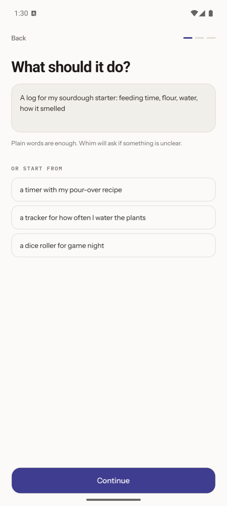
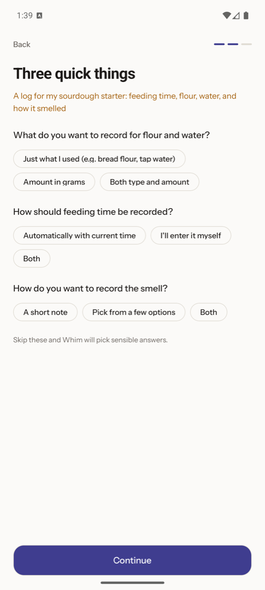
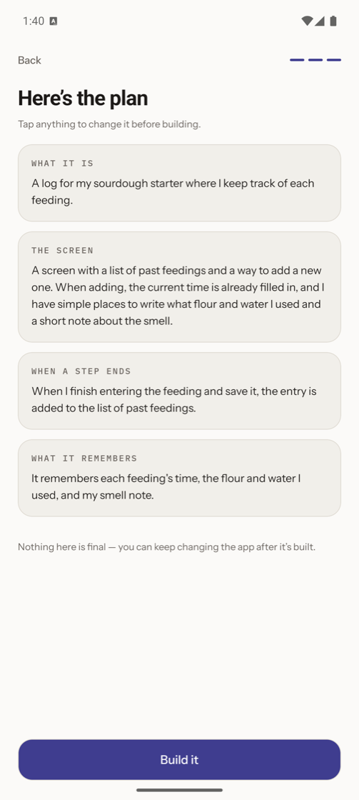
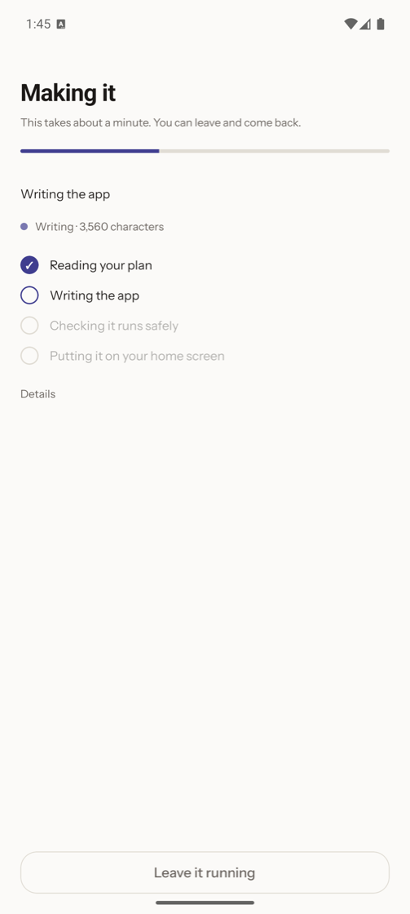
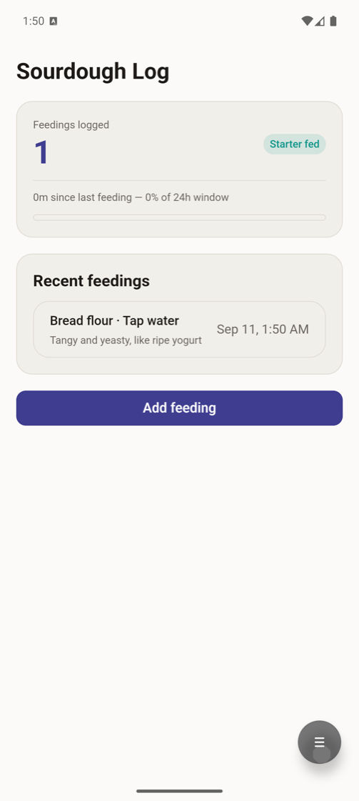
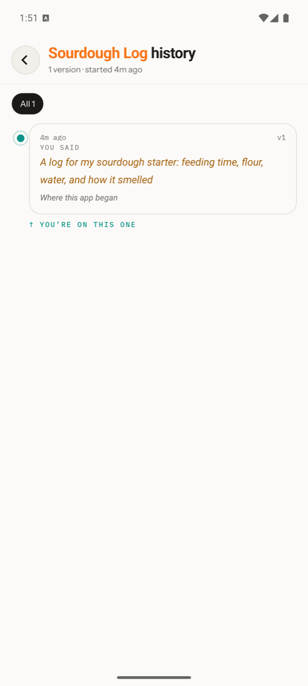
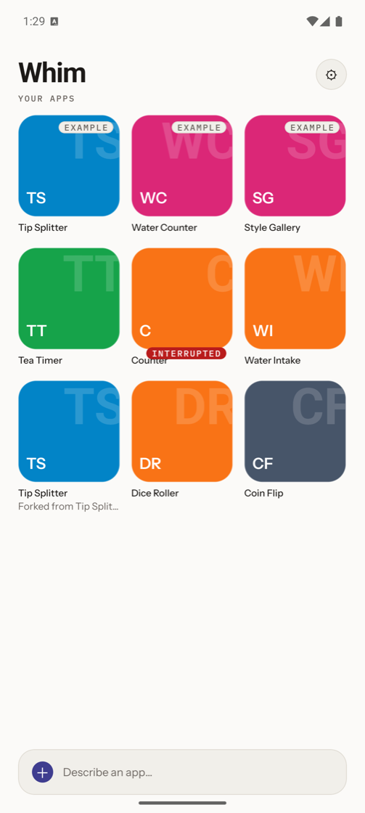
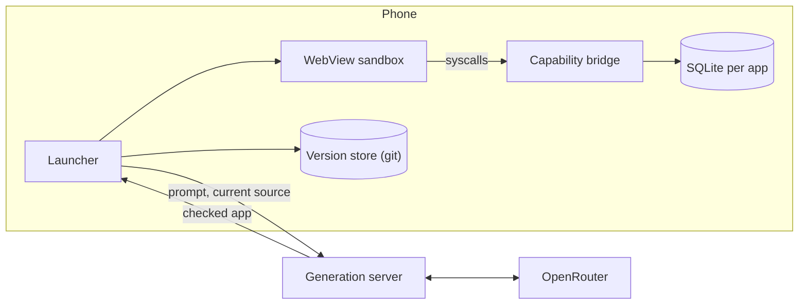

# Whim

Whim is a React Native app (iOS and Android) that builds small personal apps from a description. You describe the app, a server generates it with a language model, and it runs on your phone in a sandboxed WebView. You can change it the same way later, and every version is kept on the device.

Beta: [TestFlight](https://testflight.apple.com/join/tM69UkDf) on iOS, or sign up at [whim.anycognition.ca/beta](https://whim.anycognition.ca/beta) for iOS or Android.

<p align="center">
  
  
  
  
</p>
<p align="center">
  
  
  
</p>

*One run on the Android emulator in September 2026. The prompt was "A log for my sourdough starter: feeding time, flour, water, and how it smelled".*

There is also a [one-minute video](https://www.linkedin.com/feed/update/urn:li:activity:7504626219317923840/) of a tea timer being described, built, changed, force-quit and reopened, then copied from an older version.

## How a session works

1. **Describe.** You type what you want. Whim asks up to three questions with tappable answers (each defaults to "Decide for me") and shows the plan in plain words. You can edit any line of the plan. Nothing is sent for generation until you tap Make it.
2. **Make.** The server plans, generates one TypeScript file against the SDK, runs static checks on it, builds it, and boots it in a headless copy of the phone's sandbox page, where it taps through the app's interactive elements. Failures go back to the model as structured diagnostics, for up to three repair rounds. The phone shows the current step, elapsed time, queue position and a notice if the stream goes quiet for 40 seconds.
3. **Use.** The app appears on the home grid and opens full screen. Its data stays on the device. Opening an app needs no network.
4. **Change.** A change request sends the app's current source and data schema to the server and runs the same flow. If the app is on its latest version, the change becomes a new version of the same app. If you had switched to an older version first, the change becomes a new app that shares the original's data.
5. **History.** Every generation is a saved version. From History you can switch to any version (with Undo) or make a copy of it as a separate app, with a copy of its data or empty.

## Sandbox

A mini-app is code nobody reviewed, so the runtime treats it as hostile. Each app runs inside a WebView, in an iframe that the WebView page creates. Containment has four parts, and each one closes something the others leave open:

1. **Sandboxed iframe.** The app runs in `<iframe sandbox="allow-scripts" srcdoc=…>`. Without `allow-same-origin` the frame has an opaque origin, so `parent.document`, `top.location` and the outer page's native bridge throw a `SecurityError`. The only way out is `parent.postMessage`.
2. **Content Security Policy.** The iframe document sets `default-src 'none'; script-src 'unsafe-inline'; connect-src 'none'` (plus `none` for frames, workers, forms and base URI). There is no `unsafe-eval`, and this is the only defense against `({}).constructor.constructor('…')`: every object reaches `Function` through its prototype chain, so removing globals can't close it. `eval` and `Function` are left in place because React uses `Function`; the CSP blocks code generation in the engine. `blob:` and `data:` scripts are refused.
3. **Neutralized globals.** `neutralize.js` runs first in the iframe and replaces `fetch`, `XMLHttpRequest`, `WebSocket`, `EventSource`, `RTCPeerConnection` (and `webkitRTCPeerConnection`), `localStorage`, `sessionStorage`, `indexedDB`, `caches`, `Worker`, `SharedWorker` and `navigator.sendBeacon` with non-configurable stubs that throw when called. It covers what the CSP doesn't: WebRTC ignores `connect-src`. The stubs are on `window`, so a `<script>` the app injects itself sees them too.
4. **Native network refusal** (decision #74). A sandboxed frame can still navigate itself (`location.href = 'http://…?data'`), and no web-layer rule stops that. So the WebView refuses every network load. On Android a subclassed WebView manager sets `blockNetworkLoads` before any content loads. On iOS a `WKContentRuleList` blocks `http(s)` and `ws(s)` for every frame, and if the list hasn't compiled, the WebView starts with JavaScript off. Mini-apps never need the network; generation and reports use React Native's own networking.

Every launch gets a fresh iframe. In the pen test, loading a second app into the same iframe let the first one leave a backdoor on `window` and `Object.prototype` that the second one inherited (confirmed on Android), so the host never reuses one.

After the first paint, the loader runs a set of 49 containment probes, using a reference it captured before the app's code ran, and reports the result to the host. The probe set includes planted leaks that must be flagged, so a broken probe can't report success. On the server the same page runs in headless Chromium, and a failed containment verdict ends the run: nothing is delivered and nothing about it goes back to the model.

`npm run invariants` runs these checks against the current build in headless Chromium. It loads adversarial bundles from `fixtures/adversarial/` (escape attempts, a forged verdict, cross-version poisoning, a timer that outlives its realm), checks that a `blob:` script is refused, and runs a copy of the page with `unsafe-eval` added, which the suite must flag. It runs in CI on every pull request and every push to main. Desktop Chromium can't test the native network refusal, so that one has a device probe (`scripts/netdeny/run.mjs` with a canary server), and the release checks fail if its Android or iOS wiring is weakened.

## Capabilities

Storage, haptics and sound are only reachable as syscalls. The SDK's `storage` and `cues` objects post a request to the host, and the host checks it in a fixed order:

1. the method is registered,
2. its capability is declared in the app's manifest,
3. the permission hook allows it,
4. the params match the method's schema.

Every refusal is a structured error with a kind and a fix hint. The manifest is extracted from the source by the static checker and saved with each version; the host never asks the running app what it declared. Each realm is bound to one app when it is created, so a syscall carries no app id. Syscall ids are deduplicated per realm, and a realm reset starts a new generation, so late results from a torn-down realm are dropped. The registry is append-only.

Each app's data lives in its own SQLite database (op-sqlite). The engine has a fixed set of verbs (`kv.get/set/remove`, `records.append/list/update/remove`) and host-written SQL. Values are always bound as parameters, and collection and field names resolve through the declared schema to engine-assigned ids, so app text never reaches a SQL string. A `sql-injector` fixture tests this end to end through the sandbox. Schemas only grow: field ids are never reused, and a rename only changes the display name.

## SDK

Mini-apps are written against `vc-sdk`, which has 37 runtime exports (components, `storage`, `cues`, `nav`, timers, `Chart`). The model's view of it is one file, [`docs/sdk-reference.md`](docs/sdk-reference.md) (280 lines), sent with every generation; a server test checks it against the SDK's actual exports. Components take semantic tokens, never raw colors or sizes, so the host's theme decides how every app looks, including versions generated before a theme change. Apps follow the phone's light or dark mode. The SDK exposes no HTML or DOM.

A mini-app is one TypeScript file that imports only `vc-sdk` and default-exports `defineApp(...)`. esbuild compiles it to a single IIFE (4 to 6 KiB for the sample apps) with `vc-sdk`, `react` and `react-dom` external. At runtime the resolver knows only those three names and throws on anything else, and the static checks reject other imports before the build.

## Versions

Each app is a git repository on the device: isomorphic-git running under Hermes, stored in MMKV. The version store's API uses product verbs (snapshot, history, diff, rollback, pin, fork), and a test asserts that no return value contains a commit hash or a git field name. isomorphic-git has no garbage collection, so the store packs reachable objects and drops loose ones once the loose-object count passes 80.

## Architecture

The phone holds the apps, their data and their history. The server holds the prompts, model access and checks. It stores no app source, data or history; it keeps per-device usage limits, a request ledger and user-sent reports.



The server is a Hono app that streams progress over SSE and runs on Cloud Run. The generation loop (plan, generate, check, build, run, repair) is a state machine whose stages are injected interfaces, so it is tested against fakes. Models are called through OpenRouter; the model for each role is set by environment variables.

## Measurements

Unless noted, measured on an arm64 Android emulator (Android System WebView, Hermes, release build, software GL).

| | |
|---|---|
| Containment probes | 49 of 49 contained on every launch in the October 2026 verification run (42 of 42 in the first device run) |
| Mount to first paint | about 119 ms on a cold WebView, 32 ms on a recreated iframe |
| Tap to first paint, prewarmed WebView | 75 ms median, 84 ms p90 over 30 launches |
| Snapshot, rollback, fork | 45 to 86 ms, 58 to 183 ms, 37 to 68 ms |
| Storage per version | about 650 bytes and 4 git objects |
| Persistence | 3 kill-and-relaunch cycles, no failures |
| Syscall round trip | 16 to 17 ms median, dominated by the two WebView-to-native crossings |
| Generate phase (production server, 22 prompts, Sept 2026) | 53 s median, 144 s p90, 225 s worst; 21 of 22 produced an app |

## Status

iOS and Android builds are in beta on TestFlight and Google Play closed testing, with the server in production on Cloud Run. Open: the formal end-to-end v1 acceptance on a fresh device, voice input, and network-refusal runs on a physical device.

## How it is built

- Each risky unknown got a throwaway spike with a written hypothesis and an on-device result. The spike code is deleted; the findings are in [`docs/`](docs/).
- [`docs/decisions.md`](docs/decisions.md) is a numbered log of decisions with the alternatives each one rejected, reversals included.
- The bundle contract was pen-tested before it went into the product. Each attack that worked became a constraint and then a CI check.
- Changes go through [OpenSpec](openspec/) (proposal, design, tasks, archive). The capability specs in `openspec/specs/` describe current behavior.
- Most implementation is done by coding agents in separate git worktrees. Each change is checked against a pinned base commit, and each new test has to fail before the fix and pass after it.
- [`DEVLOG.md`](DEVLOG.md) records the dead ends.

## Repository map

```
src/host/     RN shell: launcher, capability bridge, storage engine, version store
src/runtime/  sandbox runtime inside the WebView (neutralize, resolver, probes, loader, syscall)
src/sdk/      vc-sdk, the SDK mini-apps are written against
build/        esbuild pipeline: mini-app bundles and the runtime HTML the WebView loads
server/       @whim/server: Hono generation server (SSE, admission limits, the state machine)
contract/     @whim/contract: zod wire schemas shared by device and server
checks/       static checks: AST passes with a closed set of diagnostic kinds
synthrun/     synthetic run: boots a candidate in headless Chromium and observes it
evals/        corpus eval runner; the holdout set is never committed
invariants/   containment suites, a blocking CI check
fixtures/     sample mini-apps and adversarial bundles that attack the sandbox
deploy/       Cloud Run server, the website, Firestore
fastlane/     store release lanes
docs/         decisions, spike findings, the SDK reference, runbooks
openspec/     specs and change history
```

## Running it

Node 22 and JDK 21.

```sh
npm install
npm run build              # runtime HTML, app bundles, artifacts
npm run invariants         # containment suite against this build (headless Chromium)
npm run launcher:test      # launcher suite (Node); vstore:test, storage:test, bridge:test, sdk:test, server:test likewise
npm run android:release -- --device <serial>   # debug-signed offline build, no Metro needed
npm run android -- --device <serial>           # debug build; start Metro first (npm start)
```

Generating apps needs the server: `npm run server:dev` with `OPENROUTER_API_KEY`, `WHIM_REWRITE_MODEL` and `WHIM_ENGINEER_MODEL` in `.env`, or `WHIM_PIPELINE=stub` for a canned pipeline (`WHIM_STUB_DELAY_MS` sets the delay before each event, 200 ms by default). Opening apps you already have doesn't need it.

Store builds go through fastlane (`docs/release/mobile.md`). Server deployment is in `docs/deploy.md`.

## License

Apache License 2.0, see `LICENSE`. If you distribute something built on this code, keep the `NOTICE` file with it. To use your own server, set it in the app under Settings → Advanced → Server address.
